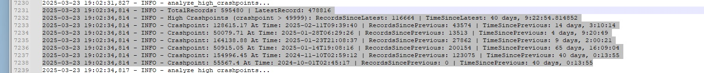

# Stake Tracker

StakeTracker is an automation tool designed to scrape and analyze historical game results from Stake.us's **Crash** and **Slide** games. It tracks high multipliers, identifies rare patterns, and outputs historical trends to both CSV and JSON.

---

## 🔧 Features

- Scrapes Crash & Slide game history using browser automation
- Stores and appends new records to CSV files
- Optionally writes to MySQL (toggle via `USE_DATABASE`)
- Tracks "high multipliers" against thresholds and logs time since last occurrence
- Supports Chrome or Firefox headless automation
- Easily extendable thresholds for deeper analytics

---

## 🖥️ Example Output

This is an actual log snapshot of `crashpoint` analysis for values above 49999:



---

## 📁 Project Structure

```bash
.
├── main.py                  # CLI entry point
├── stake_shared.py         # Shared logic for both games
├── requirements.txt
└── data/
    ├── crash_data.csv      # Auto-generated
    ├── slide_data.csv      # Auto-generated
    ├── overXXXXcrash.json  # Auto-generated analysis files
    └── overXXXXslide.json
```

---

## 📦 Installation

### 🔩 Requirements

- Python 3.8+
- Firefox + GeckoDriver or Chrome + ChromeDriver
- MySQL database (optional)

### 🧪 Setup Environment

Install dependencies:

```bash
pip install --upgrade --force-reinstall --no-cache-dir -r requirements.txt
```

---
## 🚀 Usage

```bash
python main.py stake_task       # the game comes from stake_task.mode in config.json (CRASH or SLIDE)
```

---

## ⚙️ Configuration

### 🔐 Environment Variables

Set these in your environment or `.env` file:

```bash
# Required
BROWSER_TYPE=FIREFOX           # or CHROME
BROWSER_EXE_LOC=/path/to/browser
GECKO_EXE_LOC=/path/to/geckodriver
BROWSER_PROFILE_DIR=/path/to/firefox-profile

# Optional: only if USE_DATABASE=True
MYSQL_HOST=localhost
MYSQL_USER=your_user
MYSQL_PASS=your_password
MYSQL_DB=your_database
```

### 🧠 Settings Flags (in `stake_shared.py`)

```python
DEBUG_ENABLED = True           # Show verbose logs and JS debug
USE_DATABASE = True            # Save data to MySQL in addition to CSV
```

---

## 📊 Output Files

- `stake_crash.log` / `stake_slide.log` — main file used to look back on all records.
- `data/crash_data.csv` / `data/slide_data.csv` — historical raw data
- `data/overXXXXXcrash.json` — records above defined thresholds

---

## 📚 Requirements

See `requirements.txt`, or install manually:

```bash
selenium==4.10.0
beautifulsoup4==4.12.2
pandas==2.0.3
mysql-connector-python==9.1.0
```

---

## ✅ Tips

- First run will create CSV from MySQL if missing
- To reset and rebuild from database: delete the CSV and re-run
- Use log output to inspect records since last high multiplier hit
